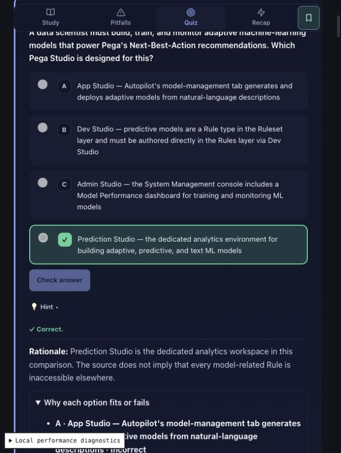

# Quiz answer-bias remediation — 2026-10-15

Final release review: [source clarifications, recovery behavior and publication checks](quiz-bias-release.md) supersedes the earlier unresolved-question list below.

Follow-up: [all module/topic coverage and additional fixes](topic-quiz-bias.md). This report describes the first remediation pass; linked audit tables include the latest wording checks.

Branch: `codex/quiz-answer-bias`. No commit, push or deployment performed.

## Findings and before/after

The reported CSA issue is in the source data, not a renderer sorting bug. Both Practice Quiz and Smart Review display the authored array order. Smart Review builds `cardBank[moduleId + '::' + questionId]` from each module's `practiceQuiz`; it does not maintain separate questions or options. A static data rewrite therefore fixes both surfaces consistently.

Audited all 210 registered module quizzes and 32 mock banks across 11 tracks: 2,844 questions, including 2,433 single-select and 411 multi-select (358 with two correct answers, 52 with three, one with five; unchanged after reordering). Full bank tables, track totals and question-level editorial candidates: [before](quiz-bias-before.md), [after](quiz-bias-after.md).

| Measure | Before | After |
|---|---|---|
| Skewed module quizzes | 161 | 0 |
| Skewed mock banks | 15 | 0 |
| CSA module 1 single-select A/B/C/D | 16/1/0/0 | 4/4/4/5 |
| CSA module 2 single-select A/B/C/D | 16/0/0/0 | 4/4/4/4 |
| Overall single-select A/B/C/D/E | 1202/679/319/232/1 | 625/633/603/572/0 |
| First-position single-select answers | 49.4% | 25.7% |
| Uniquely longest correct answer | 1410 | 1405 |
| Correct answer at least twice the longest distractor (8+ words) | 225 | 219 |
| Direct answer-term hints (expanded detector) | 72 | 0 |
| Stem-echo candidates | 37 | 37 |
| Absolute-word distractor candidates | 759 | 759 |

The first audit used complete option text for hint matching (24 hits); inspection expanded detection to the named term before an explanatory dash (72 hits). The saved before/after reports use the same expanded detector. Counts describe detectable wording patterns, not certified flaws. Different option counts are assessed separately; rounding is allowed for small banks. A sole five-option single-select item moved from E; zero answers at E overall is not evidence of skew in four-option questions.

The user's observation about CSA mocks was correct: none of the six CSA forms failed the skew threshold. Their order remains unchanged except CSA Mock Exam 4 Q19, whose “All of the above” distractor moved to the logical final position. Fifteen other-track mock banks needed rebalancing (TAS2, TAPI, TDS1, TMOB and TESTIM).

## Data model and persistence

- `data/registry.json` registers tracks and module paths. `QuilynRuntime.json` loads them; `core/js/engine.js` mounts Practice Quiz through `quiz-engine.js`. Module JSON holds `practiceQuiz[]`: stable `questionId`, `type` (`single-select`/`multi-select`), `scenario`, ordered `{id,text}` options, `correctOptions` containing stable option IDs, optional `selectCount` and `hint`, and `rationale`. Reviewed questions also have `optionExplanations` keyed by option ID, source and lesson-section metadata.
- `data/mock-exams.json` is keyed by track and form name. Each row has `q` (stem), `o` (ordered strings), `a` (zero-based correct indices), `t` (single/multi/multiple), `d` (domain), `r` (rationale), and optional source-module/question lineage, source URL and feedback fields. Standalone mock rows have no durable authored question ID: existing history derives identity from content signatures. No question IDs or row order changed.
- `pq_state_#TRACK/MODULE`: version 2 answers are keyed by question ID and selected stable option IDs. Their signature sorts options by ID, so reordering preserves answers. Legacy practice states use numeric **question** positions and selected option IDs; unchanged question order preserves them too. Seven wording edits list exact `previousSignatures`, accepted during quiz restoration and backup-reference validation. The selection and grade survive; a subsequent save uses the current signature.
- `pega_universal_state` / legacy `pega_lms_state`: module completion, quiz scores/history, track mock scores and SRS. Smart Review cards use `moduleId::questionId`; they store scheduling and counts, not selected option positions. `quilyn_study` bookmarks/reading positions use module IDs. These structures are unchanged.
- `pegaMock_TRACK_FORM`: selected **numeric option indices**, checked flags, remaining time, mode/deadline and navigation metadata. Each rewritten mock row records `previousOrder` (new position → old position); new saves have `optionOrderVersion: 1`. The lazy-loaded journal reconstructs the old bank, matches signed saves exactly, maps selections on a copy, and supplies the current signature before resume. Legacy unsigned saves use the same positional mapping. Unknown signed content revisions still use the existing archive/recovery behavior. Mapping is idempotent; checked flags, timers, flags and navigation are preserved.
- `quilyn_learning` holds full historical question/option/answer snapshots and mistakes. Existing snapshots and grades remain untouched and continue to validate. Historical retries intentionally use their original snapshot, including original ordering. New attempts use updated content. This preserves audit history rather than rewriting what a learner actually saw.
- Settings backup format remains version 2 (`state` keyed by storage key), including recovery records. Original imported backups remain untouched until a resumed session saves; import validation accepts both old and new mock records. The additive order marker is validated. Tests cover unsigned and signed legacy states, repeat migration, grading, exact wording aliases, real-bank backup import and unrelated-signature recovery.

Hints are opt-in during question answering. Rationales and expanded option explanations appear after grading, including in mock review. No explanation was found visibly exposed before grading in the checked flows.

## Changes

- `scripts/audit-quiz-bias.mjs`: reusable audit/report and CI check; supports `--revision e1a36781390eaccf1458d26d55b7a42884f5c979` for baseline reproduction. Reports answer positions, multi-select correct-count/inclusion distributions, length, direct hint terms, stem echo, absolute distractors and positional/letter-dependent options.
- `scripts/rebalance-quiz-options.mjs`: seeded one-time rewrite, refuses an already migrated baseline. Preserves IDs, question order, correct-answer identities, per-option feedback keys and technical claims. Balances movable single answers and multi-select inclusions; reserves letter-dependent rows in place, so their letters remain meaningful. Changes 1,932 question option orders including the aggregate-option correction. Already balanced mock banks are retained.
- Module data: 72 direct hints removed; 13 CSA 1/2 hints rewritten as reasoning prompts. Seven options shortened without changing their intended answer; full supporting detail stays in the rationale. Six severe-length flags and five longest-answer flags were removed. The remaining editorial candidates need contextual review rather than bulk shortening or making distractors less clearly false.
- `core/js/progress.js`: exact previous-signature compatibility for the seven wording edits; accepts the additive mock order marker.
- `core/js/learning-history.js`, `core/js/mock-view.js`: safe mock restoration mapping, new-save marker, and expanded-feedback headings now use the **displayed letter and option text**, not the stable option ID.
- Corrected an unambiguous stale-letter explanation in PBA Mock Exam 2 Q5: the rationale now refers to the cross-pairings by meaning instead of incorrectly calling a correct option wrong. Its key and technical meaning are unchanged.
- `scripts/check.mjs` and `tests/quiz-bias.test.mjs`: position/reference regression gate and migration tests. Existing editorial tests now find options by stable ID; SSA accepts absent optional hints. No semantic assertions were removed.
- Regenerated `data/content-manifest.json` and updated `sw.js` cache version so offline clients can receive the changed data/code. Updated source-review inventory hashes with a separate `quizBiasRevision` record retaining the prior hash and original source-review date; no new vendor verification is claimed.

## Intentionally retained / decisions for editorial review

Length alone does not establish a giveaway, and technical absolutes can distinguish intentionally wrong claims. The after report lists all remaining candidates per bank; these were not mass-edited. Letter-dependent rows remain in their existing order unless the correction above applies. Archived `data_backup_*` copies and `data/review/ssa-mock-design.json` are not runtime quiz sources and remain unchanged. Embedded study-guide interactives are separate instructional exercises; the bank audit covers Practice Quiz, their reused Smart Review cards and every mock form, not executable HTML exercise internals.

These pre-existing questions need a source-based editorial decision; their keys were preserved:

1. **CSA / PSA Mock Exam 3 Q20**: `a=[1,2]`, but the rationale discusses different letter combinations and credits a refresh-strategy statement that is not in that key. Confirm intended sourcing/refresh statements before changing the key.
2. **TESTIM Mock Exam 2 Q30 / Mock Exam 6 Q55**: key credits an external project-management integration for checking project user activity; rationale also admits Insights exposes user activity. Verify against the intended course/version.
3. **TESTIM Mock Exam 3 Q10 / Mock Exam 6 Q38**: singular “NOT an option” stem has two keyed answers. Confirm whether these should explicitly ask for two answers; no answer-set change made.
4. **TAPI Mock Exam 6 Q1**: absolute “SOAP only supports POST” wording may describe a particular course's binding rather than all SOAP-over-HTTP possibilities. Verify the intended scope before revising.

## Verification

Reproduce:

```sh
node scripts/audit-quiz-bias.mjs --revision e1a36781390eaccf1458d26d55b7a42884f5c979 --report docs/reports/quiz-bias-before.md
node scripts/audit-quiz-bias.mjs --report docs/reports/quiz-bias-after.md --check
npm run manifest:content
npm run check
```

**Final result: all 309 tests pass; all generation/syntax/content checks pass; zero skewed banks and no invalid answer references; `git diff --check` passes.** A separate comparison against HEAD verified all 2,844 question stems, answer identities and original mock permutations. The one-time rewrite also rejects an accidental second run.

`npm run check` includes syntax validation, content/schema validation, generated-asset freshness, the bias gate and the full Node test suite. There is no separate production bundler or linter configured for this static site.

Manual local browser checks: CSA module 1 single-select answer at D; multi-select answer set B/D; rationale and expanded option feedback; saved practice answers after reload; bookmark after reload and in Bookmarks workspace; Smart Review selection, confidence, correct grade and SRS box promotion; CSA mock learning-mode grading, submission with unanswered questions, result summary and answer-review screen. Used a separate local origin with diagnostics mode for final source verification, avoiding development service-worker cache staleness.


