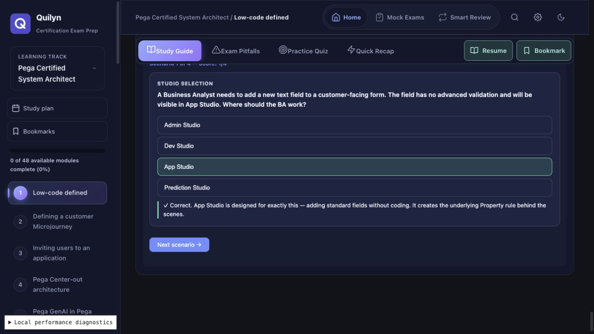

# Full module and topic follow-up — 2026-10-15

Final release review: [source clarifications, recovery behavior and publication checks](quiz-bias-release.md) supersedes the earlier unresolved-question list below.

This extends [the original remediation](quiz-bias.md). Work remains uncommitted on `codex/quiz-answer-bias`; nothing was pushed or deployed.

## Coverage

Inspected all 210 registered modules across 11 tracks, including their 817 topic references, all 32 mock banks, and every embedded study-guide interactive. The site contains 41 embedded interactives: 24 decision quizzes (81 questions), 15 reveal-answer retrieval checks, one matching exercise and one ordering exercise. All decision quizzes are in CSA/PSA modules; other tracks have no embedded decision bank in the shipped content. Vendor-hosted pages and their authenticated assessments are outside this local site audit.

Practice Quiz and Smart Review still share the same module question bank. Smart Review does not have another option dataset. The complete covered question population is now **2,925 questions in 266 banks**: 2,844 practice/mock questions plus 81 topic decisions. The 15 reveal-answer prompts are additional instructional activities, not multiple-choice questions.

## Additional findings and fixes

| Measure | Before topic fix | After |
|---|---:|---:|
| Topic decision banks with position skew | 24/24 | 0/24 |
| Topic correct positions A/B/C/D | 81/0/0/0 | 20/20/21/20 |
| Topic uniquely longest correct options | 53/81 | 28/81 |
| Topic uniquely shortest correct options | 7/81 | 10/81 |
| Topic severe length differences | 2 | 0 |
| Topic absolute-word distractor candidates | 25 | 20 |

Across both remediation passes, position-skewed banks fell from **200 to zero**. The before/after topic tables and complete interactive inventory are in [before](topic-quiz-bias-before.md) and [after](topic-quiz-bias-after.md). The updated [practice/mock report](quiz-bias-after.md) also remains clear of position skew.

- Rewrote all 81 topic option arrays deterministically, balancing within each exercise and globally. Updated numeric `correct` indices **and reordered `fbs` with their corresponding options**. No runtime shuffle was added; an exercise retains its order through next/retry/restart.
- Revised 139 option texts across 35 topic questions. Compared all four choices when simplifying, retaining meaningful action/tool distinctions and leaving full teaching detail in the original feedback. Checking both longest and shortest options prevented replacing the old longest-answer cue with a systematic shortest-answer cue.
- Removed an explicit answer annotation from the sample Case Life Cycle configuration while retaining the actual second Create Stage for the learner to identify.
- Corrected CSA module 2's draft-object exercise prompt: it asked for an incorrect claim although the keyed response was the correct description. The prompt now asks what to expect from the new draft object; its keyed technical answer and feedback are preserved.
- Removed self-disqualifying wording such as a distractor announcing that its own scope does not exist, and a competing GenAI option explicitly naming the intended answer. Tool alternatives remain distinct; ambiguous factual/course-version cases still require source review.
- Fixed stale score headers in the 22 decision exercises that did not update the displayed score immediately after grading. Header and final result now agree even on the last question. The two already-correct handlers retain their behavior.
- Applied 26 additional reviewed practice-answer wording edits across all 11 tracks. These preserve answer IDs and technical meaning; exact prior signatures are accepted during restoration and backup validation. Severe practice/mock length flags dropped from the first pass's 219 to 197. A length flag alone does not establish a bad question, so remaining candidates are reported rather than mechanically padded or truncated.

Matching already shuffles both columns; ordering already randomizes the initial order. Reveal-answer exercises hide their model responses until “Show answer”. These 17 activities were retained. Existing question IDs, module IDs, answer identities, SRS keys, bookmarks and historical snapshots remain unchanged.

## Implementation and data safety

- `scripts/audit-topic-quizzes.mjs`: inventories all interactives, extracts only the authored decision-array expressions without executing renderers, reuses the position/wording audit and fails on unclassified exercise types, bad answer references, feedback-length mismatches or skew.
- `scripts/rebalance-topic-quizzes.mjs`: reproducible, seeded one-time rewrite; rejects an already rebalanced baseline. A replay against the original topic arrays reproduced all 24 banks and their feedback mappings.
- `scripts/optimize-quiz-wording.mjs`: explicit reviewed practice edits, idempotent when already applied; appends exact old signatures before replacing text.
- `scripts/audit-quiz-bias.mjs`: now reports uniquely shortest correct choices as well as longest choices. Historical and current reports use the same detector.
- `tests/topic-quiz-bias.test.mjs`: checks all interactive classifications, every answer/feedback reference, all **324 possible selections** across 81 questions, immediate score headers, selection locking, option order after restart and literal extraction.
- `scripts/check.mjs`: includes the topic audit as a regression gate. Existing Blueprint/View content assertions now follow `correct` rather than a fixed option index.
- Module JSON remains the authored source. Regenerated hashed `core/interactives/*.js`, `data/interactive-manifest.json` and `data/content-manifest.json`. Source-review checksums retain the prior source-review date/hash with separate remediation provenance; no fresh vendor fact-check is claimed.

Embedded exercises store only transient JavaScript `cur`/`score` variables; they do not write selections or scores to localStorage, SRS or exports. Their reordered indices therefore require no user-data migration. Practice wording edits use the compatibility path from the first pass; existing mock mappings and history retention are unchanged.

## Remaining review items

The four groups of doubtful mock questions in [the original report](quiz-bias.md#intentionally-retained--decisions-for-editorial-review) remain listed for source-based review. No answer key was guessed. Other length, absolute-word and stem-echo flags remain in per-bank reports as editorial candidates: necessary technical qualifications and intentionally false distractors should not be removed solely to improve a statistic.

## Verification

```sh
node scripts/audit-topic-quizzes.mjs --revision e1a36781390eaccf1458d26d55b7a42884f5c979 --report docs/reports/topic-quiz-bias-before.md
node scripts/audit-topic-quizzes.mjs --report docs/reports/topic-quiz-bias-after.md --check
node scripts/audit-quiz-bias.mjs --report docs/reports/quiz-bias-after.md --check
npm run manifest:content
npm run check
```

**Final verification: all 313 tests pass; syntax/content/generated-asset checks, both bias gates and `git diff --check` pass. Baseline comparison confirms that all 81 topic answer/feedback mappings and all practice question/answer IDs were retained; 33 practice questions carry wording-compatibility signatures across both passes.**

Manual browser verification uses the generated iframe assets, not just the raw arrays: correct answer below the first position, wrong-choice feedback, next question, accumulated score, final result and restart. Existing practice/SRS/backup regression tests run with the new wording aliases as part of the full check.


